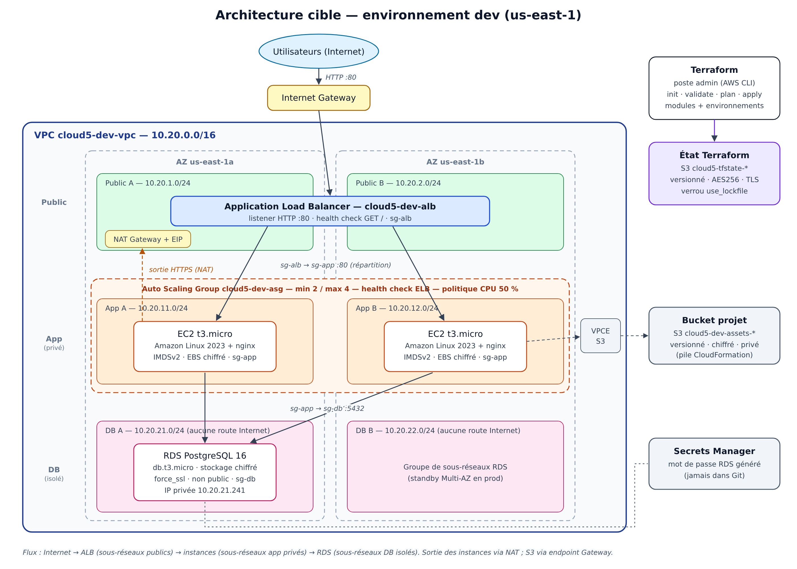

# Terraform Cloud Project — Infrastructure AWS modulaire

Infrastructure Web hautement disponible sur AWS, entièrement décrite avec Terraform : VPC multi-AZ, Application Load Balancer, Auto Scaling Group, RDS PostgreSQL privé, bucket S3 et état Terraform distant chiffré et verrouillé.

📄 **Compte rendu complet** : [`docs/RAPPORT.md`](docs/RAPPORT.md) ([version PDF](docs/rapport.pdf))



## Architecture

| Niveau | Sous-réseaux (10.20.0.0/16) | Contenu |
|---|---|---|
| Public | 10.20.1.0/24, 10.20.2.0/24 | Application Load Balancer, NAT Gateway |
| App (privé) | 10.20.11.0/24, 10.20.12.0/24 | Instances nginx de l'Auto Scaling Group |
| DB (isolé) | 10.20.21.0/24, 10.20.22.0/24 | RDS PostgreSQL 16, sans route Internet |

Flux : `Internet → ALB → instances (sg-alb → sg-app) → RDS (sg-app → sg-db)`.

## Structure du dépôt

```
bootstrap/        bucket S3 de l'état Terraform (créé une fois)
modules/          network · security · load-balancer · compute · database · storage
environments/     dev · test · prod (un état par environnement)
docs/             rapport, schéma d'architecture, captures
```

Chaque module contient `main.tf`, `variables.tf`, `outputs.tf`, `versions.tf` et un `README.md` détaillant ses entrées et sorties.

## Prérequis

- Terraform **>= 1.10** (verrou natif S3 `use_lockfile`)
- AWS CLI v2
- Un compte AWS (ce projet a été réalisé sur AWS Academy Learner Lab, région `us-east-1`)

## Authentification (sans secret en clair)

Aucun identifiant n'est présent dans le dépôt. L'AWS CLI est configurée localement :

```powershell
# Learner Lab : AWS Details → AWS CLI → copier le bloc dans ~/.aws/credentials
aws sts get-caller-identity
```

Le mot de passe de la base est généré par RDS et stocké dans AWS Secrets Manager (`manage_master_user_password = true`). Il n'apparaît ni dans le code, ni dans les tfvars, ni dans l'état.

## Déploiement

```powershell
# 1. Bootstrap — une seule fois
cd bootstrap
cp terraform.tfvars.example terraform.tfvars   # renseigner owner
terraform init
terraform plan -out=tfplan
terraform apply tfplan

# 2. Environnement dev
cd ../environments/dev
terraform init
terraform fmt -check -recursive
terraform validate
terraform plan -out=tfplan
terraform apply tfplan
terraform output alb_url
```

## Destruction

```powershell
cd environments/dev
terraform destroy
```

La NAT Gateway et l'ALB sont facturés même sans trafic : l'environnement est détruit après chaque démonstration.

## Variables principales (environnement)

| Variable | Exemple | Description |
|---|---|---|
| `project_name` | `cloud5` | Préfixe de nommage |
| `environment` | `dev` | dev, test ou prod |
| `owner` | `rayene-mabrouk` | Tag Owner |
| `vpc_cidr` | `10.20.0.0/16` | Les 6 sous-réseaux en sont dérivés |
| `nat_mode` | `single` | none, single ou per_az |
| `instance_type` | `t3.micro` | Type d'instance |
| `min_size` / `max_size` | `2` / `4` | Capacité de l'ASG |
| `db_instance_class` | `db.t3.micro` | Classe RDS |

## Sorties

`alb_url`, `asg_name`, `vpc_id`, `rds_address`, `rds_secret_arn`, `assets_bucket`.

## Conventions

- Noms : `<projet>-<environnement>-<ressource>`
- Tags obligatoires sur toutes les ressources : `Project`, `Environment`, `Owner`, `ManagedBy`
- Variables typées, décrites et validées ; aucune valeur sensible dans `terraform.tfvars`

## Coûts et limites connues

- Environnement dev ≈ 0,13 $/h (≈ 93 $/mois en continu), dont la NAT Gateway est le premier poste. Détail dans le rapport.
- HTTP seul en dev (pas de certificat ACM dans le lab) ; HTTPS activable via `certificate_arn`.
- Learner Lab : pas de création de rôles IAM (profil `LabInstanceProfile`), et une SCP bloque la lecture de `aws_s3_bucket` : les buckets sont gérés par source de données (état) et par pile CloudFormation (bucket projet).

## Dépannage

| Symptôme | Cause probable | Action |
|---|---|---|
| `Unable to locate credentials` | Fichier `credentials` absent ou enregistré en `.txt` | Vérifier `~/.aws/credentials` |
| `ExpiredToken` | Session Learner Lab expirée | Relancer le lab et recopier les identifiants |
| Cibles *unhealthy* après l'apply | Instances en cours de démarrage | Attendre 2 à 3 minutes |
| Site injoignable dans le navigateur | Le navigateur force HTTPS | Ouvrir l'URL en `http://` ou tester avec `curl` |
| `Error acquiring the state lock` | Une autre exécution est en cours | Attendre la fin, ne pas forcer le verrou |

## Licence

[MIT](LICENSE)
