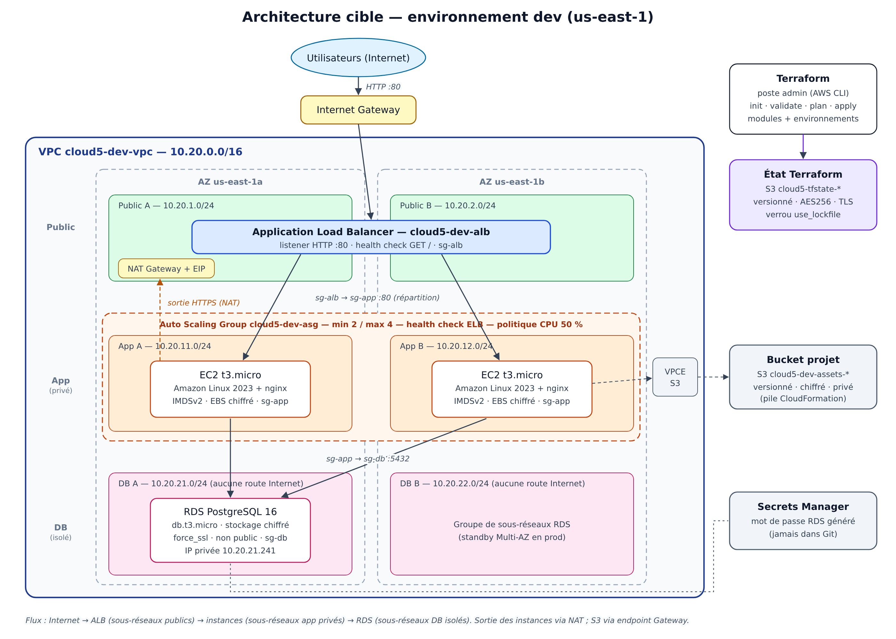

# Projet Terraform et CI/CD — Compte rendu

**Conception et déploiement automatisé d'une plateforme Cloud complète sur AWS**

| | |
|---|---|
| **Étudiant** | Rayene Mabrouk |
| **Établissement** | EPI Digital School — Sousse |
| **Parcours** | Cloud Computing et Réseaux |
| **Mode de travail** | Individuel |
| **Cloud** | AWS (AWS Academy Learner Lab, région `us-east-1`) |
| **Date** | Novembre 2026 |

## Sommaire

1. Introduction et objectifs
2. Contexte et contraintes de l'environnement
3. Architecture
4. Organisation du dépôt et conventions
5. Backend distant et gestion de l'état
6. Modules Terraform
7. Environnements
8. Choix de sécurité
9. Pipeline CI/CD
10. Tests et résultats
11. Estimation des coûts
12. Difficultés rencontrées et solutions
13. Améliorations possibles
14. Conclusion
15. Annexes

---

## 1. Introduction et objectifs

Une organisation souhaite héberger une application Web dans le Cloud. L'infrastructure doit être hautement disponible, protéger les instances et la base de données dans des sous-réseaux privés, résister à la panne d'une instance et répartir les requêtes entre plusieurs serveurs.

L'objectif du projet est de décrire toute cette infrastructure en code avec Terraform, de façon **modulaire, sécurisée et reproductible**, puis de la déployer, la tester et la détruire de manière contrôlée.

Objectifs pédagogiques traités :

- concevoir une architecture Cloud fiable et sécurisée ;
- développer des modules Terraform réutilisables ;
- gérer plusieurs environnements (dev, test, prod) avec des états séparés ;
- mettre en place un backend distant pour l'état Terraform ;
- gérer les secrets sans les enregistrer dans le dépôt Git ;
- tester, documenter et présenter l'infrastructure.

## 2. Contexte et contraintes de l'environnement

Le projet a été réalisé sur un compte **AWS Academy Learner Lab**. Cet environnement impose des contraintes qui ont orienté plusieurs choix techniques :

| Contrainte du Learner Lab | Conséquence | Solution retenue |
|---|---|---|
| Régions limitées | `eu-west-3` (exemple de l'énoncé) indisponible | Déploiement en `us-east-1` |
| Création de rôles IAM interdite | Pas de rôle dédié aux instances ni de fournisseur OIDC | Profil existant `LabInstanceProfile` |
| SCP bloquant `s3:GetBucketObjectLockConfiguration` | La ressource `aws_s3_bucket` échoue à la lecture | Contournement décrit en section 5 et 6.3 |
| Identifiants temporaires (session de 4 h) | Les clés changent à chaque session | Aucun identifiant dans le code ; AWS CLI configurée localement ; GitHub Secrets chiffrés pour le pipeline, mis à jour par script |
| Budget de 50 USD | Les ressources payantes consomment le budget | Environnement détruit après chaque démonstration |

Outils utilisés : Terraform 1.16.2, fournisseur `hashicorp/aws` 5.100.0, AWS CLI 2.37, Git, GitHub CLI, GitHub Actions et PowerShell sous Windows 11.

## 3. Architecture

### 3.1 Schéma



### 3.2 Composants

| Composant | Rôle |
|---|---|
| VPC `10.20.0.0/16` | Réseau isolé, réparti sur deux zones de disponibilité (`us-east-1a`, `us-east-1b`) |
| 2 sous-réseaux publics | Application Load Balancer et NAT Gateway |
| 2 sous-réseaux privés « app » | Instances de l'Auto Scaling Group |
| 2 sous-réseaux privés « db » | Base RDS, sans aucune route vers Internet |
| Internet Gateway | Entrée et sortie Internet du niveau public |
| NAT Gateway | Sortie contrôlée (sortante uniquement) des instances privées |
| Endpoint S3 (Gateway) | Accès à S3 sans passer par la NAT, gratuit |
| Application Load Balancer | Point d'entrée HTTP, répartition et health checks |
| Launch Template + Auto Scaling Group | Instances Web identiques, remplacées automatiquement en cas de panne |
| RDS PostgreSQL 16 | Base de données privée et chiffrée |
| Bucket S3 projet | Ressources, journaux et sauvegardes |
| Bucket S3 d'état | État Terraform centralisé, versionné et chiffré |

### 3.3 Plan d'adressage

Les sous-réseaux sont calculés automatiquement à partir du CIDR du VPC avec la fonction `cidrsubnet()`. Avec `10.20.0.0/16`, on obtient exactement le plan demandé par l'énoncé :

| Sous-réseau | CIDR | Zone |
|---|---|---|
| Public A | 10.20.1.0/24 | us-east-1a |
| Public B | 10.20.2.0/24 | us-east-1b |
| Privé App A | 10.20.11.0/24 | us-east-1a |
| Privé App B | 10.20.12.0/24 | us-east-1b |
| Privé DB A | 10.20.21.0/24 | us-east-1a |
| Privé DB B | 10.20.22.0/24 | us-east-1b |

### 3.4 Routage

| Niveau | Route `0.0.0.0/0` | Effet |
|---|---|---|
| Public | Internet Gateway | Joignable depuis Internet (ALB uniquement) |
| App | NAT Gateway | Sortie uniquement (installation des paquets) |
| DB | Aucune | Totalement isolé d'Internet |

### 3.5 Flux

`Utilisateur → Internet Gateway → ALB (public) → instance Web (app) → RDS (db)`

## 4. Organisation du dépôt et conventions

```
terraform-cloud-project/
├── .github/workflows/
│   └── terraform.yml       # pipeline CI/CD (GitHub Actions)
├── bootstrap/              # création du bucket d'état (état local puis migré)
├── modules/
│   ├── network/            # VPC, sous-réseaux, IGW, NAT, routage, endpoint S3
│   ├── security/           # Security Groups chaînés
│   ├── load-balancer/      # ALB, Target Group, listeners
│   ├── compute/            # Launch Template, ASG, politique de scaling, user_data
│   ├── database/           # RDS, subnet group, parameter group
│   └── storage/            # bucket S3 projet
├── environments/
│   ├── dev/                # environnement déployé et testé
│   ├── test/
│   └── prod/
├── scripts/
│   └── set-github-secrets.ps1   # copie les identifiants du lab dans GitHub Secrets
├── docs/                   # rapport, schéma, captures
├── .gitignore
└── .gitattributes
```

Chaque module contient `main.tf`, `variables.tf`, `outputs.tf`, `versions.tf` et un `README.md` (usage, entrées, sorties, exemple).

**Conventions appliquées :**

- **Nommage** : `<projet>-<environnement>-<ressource>`, par exemple `cloud5-dev-alb` ou `cloud5-dev-sg-app`.
- **Tags obligatoires** : `Project`, `Environment`, `Owner` et `ManagedBy`, appliqués automatiquement à toutes les ressources par le bloc `default_tags` du fournisseur.
- **Variables** : en `snake_case`, typées, décrites, et validées sur les valeurs critiques (CIDR, environnement, nombre d'AZ, `min_size >= 2`, classe RDS…).
- **`locals`** pour les noms et tags communs, **`for_each`** pour créer une ressource par zone sans duplication.
- **Aucune dépendance implicite cachée** : l'ordre de création est déduit des références entre modules (`module.network.vpc_id`, etc.), sans `depends_on` artificiel.
- **Git** : un commit par modification cohérente, au format *Conventional Commits* (`feat(network): …`, `chore: …`). Fin de lignes LF imposée par `.gitattributes`.
- **Fichiers exclus** (`.gitignore`) : `.terraform/`, `*.tfstate*`, `tfplan`, `plan.txt`, `backend.hcl`, `bootstrap/terraform.tfvars`, les fichiers `*.secret.tfvars`, et les fichiers de verrou des modules.

## 5. Backend distant et gestion de l'état

### 5.1 Exigences et réalisation

| Exigence (§16.1) | Réalisation |
|---|---|
| Stockage distant | Bucket S3 `cloud5-tfstate-530008597446` |
| Chiffrement | SSE-S3 (AES256) et paramètre `encrypt = true` du backend |
| Versioning | Activé ; versions anciennes expirées après 90 jours |
| Verrouillage | `use_lockfile = true` : verrou natif S3, sans DynamoDB |
| Séparation des états | Une clé par environnement : `dev/`, `test/`, `prod/`, `bootstrap/` |
| Accès limité | Blocage complet de l'accès public, ACL désactivées, refus des requêtes non TLS |

Le verrou natif `use_lockfile` nécessite **Terraform ≥ 1.10**. L'énoncé cite `required_version = ">= 1.6.0"` tout en utilisant `use_lockfile` dans son exemple. La contrainte a donc été relevée à `>= 1.10.0`.

### 5.2 Bootstrap

Le bucket d'état ne peut pas être géré par une configuration qui l'utilise déjà comme backend. Une configuration séparée `bootstrap/` le crée d'abord avec un état local. Elle ajoute ensuite le bloc `backend "s3"` et migre son propre état dans le bucket (`terraform init -migrate-state`), sous la clé `bootstrap/terraform.tfstate`. Ainsi, aucun état ne reste uniquement sur le poste de travail.

### 5.3 Contournement de la SCP du Learner Lab

Au premier `apply`, la création du bucket a réussi, mais la lecture qui suit a été refusée :

```
not authorized to perform: s3:GetBucketObjectLockConfiguration ...
with an explicit deny in a service control policy
```

La ressource `aws_s3_bucket` du fournisseur AWS lit systématiquement cette configuration ; elle est donc inutilisable dans ce compte. Solution : le bucket est créé une seule fois, Terraform le référence par une source de données (`data "aws_s3_bucket"`), et Terraform gère toujours tout son durcissement (versioning, chiffrement, blocage public, propriété, cycle de vie, politique TLS). L'entrée orpheline a été retirée de l'état avec `terraform state rm`, sans rien supprimer dans AWS.

## 6. Modules Terraform

### 6.1 `network`

- VPC avec résolution DNS activée (nécessaire aux noms d'hôte RDS).
- 6 sous-réseaux créés avec `for_each` sur les zones de disponibilité.
- Variable `nat_mode` : `none` (aucune NAT), `single` (une NAT partagée, dev/test) ou `per_az` (une NAT par zone, prod). Une table de routage par zone pour le niveau app, afin qu'en `per_az` le trafic reste dans sa zone.
- Table de routage DB sans aucune route par défaut.
- Endpoint S3 de type Gateway, gratuit, associé aux tables de routage app.

### 6.2 `security`

Trois Security Groups chaînés, dont chaque règle est une ressource distincte (`aws_vpc_security_group_ingress_rule` / `egress_rule`) et donc lisible individuellement dans le plan :

| Security Group | Entrant | Sortant |
|---|---|---|
| `sg-alb` | 80 depuis `0.0.0.0/0` (443 si HTTPS activé) | port applicatif vers `sg-app` uniquement |
| `sg-app` | port applicatif depuis `sg-alb` uniquement | 443 (paquets via NAT), 5432 vers `sg-db` |
| `sg-db` | 5432 depuis `sg-app` uniquement | aucun |

Les règles référencent des Security Groups et non des adresses IP : elles restent valides quand l'Auto Scaling Group remplace les instances.

### 6.3 `storage`

Bucket S3 privé du projet : versioning, chiffrement AES256, blocage public, ACL désactivées, refus du transport non TLS, cycle de vie (journaux `logs/` supprimés après 30 jours, anciennes versions après 30 jours, téléversements incomplets après 7 jours).

À cause de la même SCP que pour le bucket d'état, le bucket est déclaré dans une **pile CloudFormation pilotée par Terraform** (`aws_cloudformation_stack`, modèle généré avec `jsonencode()`). Terraform ne lit que la pile, jamais la configuration du bucket ; l'infrastructure reste entièrement en code, et `terraform destroy` supprime la pile et le bucket.

### 6.4 `load-balancer`

- ALB public dans les deux sous-réseaux publics, `drop_invalid_header_fields = true` (protection contre le *request smuggling*).
- Target Group HTTP avec health check `GET /` attendant un code 200, toutes les 15 s ; 2 échecs consécutifs rendent une cible *unhealthy* (≈ 30 s).
- Listener 80. Si la variable `certificate_arn` est renseignée, un listener 443 (politique TLS 1.2/1.3) est créé et le port 80 redirige en 301 vers HTTPS, sans modification du code.

### 6.5 `compute`

- AMI Amazon Linux 2023 résolue au moment du plan via le paramètre SSM public (aucun identifiant d'AMI codé en dur).
- Launch Template durci : IMDSv2 obligatoire, volume racine gp3 chiffré, aucune clé SSH.
- `user_data` (gabarit `templatefile`) : installation de nginx et page de démonstration affichant le nom d'hôte, l'ID d'instance, la zone, l'IP privée et l'état de joignabilité de la base.
- Auto Scaling Group sur les deux sous-réseaux app, `health_check_type = "ELB"` (une instance déclarée défaillante par l'ALB est remplacée), *instance refresh* progressif, politique de suivi de cible sur l'utilisation CPU moyenne (50 %).
- `desired_capacity` est ignoré après création (`ignore_changes`) : la capacité appartient ensuite à la politique de scaling.

### 6.6 `database`

- RDS PostgreSQL 16 (`db.t3.micro` en dev), stockage gp3 chiffré, `publicly_accessible = false`.
- Groupe de sous-réseaux limité aux sous-réseaux DB, groupe de paramètres imposant `rds.force_ssl = 1` et journalisant les connexions.
- **Mot de passe géré par RDS** (`manage_master_user_password = true`) : il est généré et stocké dans Secrets Manager. Il n'apparaît ni dans le code, ni dans les tfvars, ni dans l'état Terraform.
- Protection contre la suppression et snapshot final pilotés par variable : désactivés en dev pour une destruction rapide, prévus en prod.

## 7. Environnements

Chaque environnement possède son propre dossier, ses variables et son propre état ; les modules restent communs. Les différences de capacité passent uniquement par des variables.

| Paramètre | dev | test | prod |
|---|---|---|---|
| Clé d'état | `dev/terraform.tfstate` | `test/terraform.tfstate` | `prod/terraform.tfstate` |
| CIDR VPC | 10.20.0.0/16 | 10.30.0.0/16 | 10.40.0.0/16 |
| NAT | `single` | `single` | `per_az` |
| Instances | t3.micro, 2 à 4 | t3.micro, 2 à 4 | t3.small, 2 à 6 |
| RDS | db.t3.micro, mono-AZ | db.t3.micro, mono-AZ | db.t3.small, Multi-AZ |
| Protection suppression | non | non | oui |
| Approbation avant apply | non | oui (GitHub Environment) | oui (GitHub Environment) |
| Ressources planifiées | 40 | 40 | 42 (2 NAT + 2 EIP) |

Les trois environnements partagent exactement le même code ; seuls `terraform.tfvars` et la clé d'état diffèrent. **dev** a été déployé et testé manuellement ; **prod** a été déployé de bout en bout par le pipeline CI/CD avec approbation, puis détruit ; **test** est validé et planifié par le pipeline. La différence de 42 ressources en prod (contre 40) illustre bien l'effet des variables : `nat_mode = "per_az"` crée une NAT Gateway et une Elastic IP par zone.

## 8. Choix de sécurité

| Règle de l'énoncé (§8) | Mise en œuvre |
|---|---|
| L'ALB accepte HTTP/HTTPS depuis Internet | `sg-alb` : 80 ouvert ; 443 ouvert uniquement si un certificat est fourni |
| Les instances n'acceptent le Web que depuis l'ALB | `sg-app` : port 80 depuis `sg-alb` uniquement |
| La base n'accepte que le SG applicatif | `sg-db` : 5432 depuis `sg-app` uniquement, aucune sortie |
| Aucun secret dans Git | Mot de passe RDS généré par AWS ; aucune clé d'accès dans le dépôt ; tfvars sans valeur sensible |
| Accès administratif limité et justifié | Aucune clé SSH, port 22 fermé partout ; administration prévue via SSM Session Manager |
| Buckets S3 non publics | Blocage public complet sur les deux buckets, ACL désactivées |
| Chiffrement des données sensibles et de l'état | État S3 AES256 + TLS imposé ; RDS chiffré au repos et en transit ; volumes EBS chiffrés |
| Rôles IAM au moindre privilège | Contraint par le Learner Lab : `LabInstanceProfile` imposé (limite documentée) |

**Défense en profondeur autour de la base** : réseau (sous-réseaux sans route Internet), pare-feu (`sg-db`), transport (SSL obligatoire), stockage (chiffré) et secret (géré par AWS).

**Durcissement des instances** : IMDSv2 obligatoire (protection contre le vol d'identifiants par SSRF), disque chiffré, aucune clé SSH.

**Limites connues** : HTTP seul en dev, faute de certificat ACM dans le lab (HTTPS activable par variable) ; profil IAM du lab plus large que nécessaire, à remplacer par un rôle dédié hors Learner Lab.

## 9. Pipeline CI/CD

### 9.1 Principe

Le pipeline est un workflow **GitHub Actions** (`.github/workflows/terraform.yml`). Aucune modification n'atteint AWS sans être formatée, validée, planifiée, relue et approuvée.

| Déclencheur | Étapes |
|---|---|
| Pull Request vers `main` | `terraform fmt -check`, `terraform validate` (bootstrap + 3 environnements), contrôle qu'aucun état ni secret n'est suivi par Git, puis `plan` pour dev, test et prod ; chaque plan est publié en commentaire de la PR |
| Push sur `main` | mêmes contrôles et mêmes plans |
| Lancement manuel (`workflow_dispatch`) | `plan` de l'environnement choisi, puis `apply` ou `destroy` **du plan exact relu**, après approbation dans le GitHub Environment |

### 9.2 Garde-fous

- **Validation manuelle** : les GitHub Environments `test` et `prod` exigent l'approbation d'un relecteur avant tout `apply` ; `dev` est libre.
- **Plan relu = plan appliqué** : le fichier `tfplan` produit par le job `plan` est transmis comme artefact au job `apply`, qui applique ce fichier et rien d'autre.
- **Branche protégée** : `apply` et `destroy` ne sont autorisés que depuis `main`.
- **Production protégée** : la destruction de prod par le pipeline est refusée ; la base de prod a en plus une protection contre la suppression.
- **Un déploiement à la fois** par environnement (`concurrency`) et verrou d'état S3.

### 9.3 Gestion des secrets du pipeline

L'identité fédérée (OIDC) recommandée par l'énoncé suppose de créer un fournisseur d'identité et un rôle IAM, ce que le Learner Lab interdit. Conformément à l'alternative prévue (« stocker les secrets dans le coffre sécurisé de la plateforme CI/CD »), les identifiants temporaires du lab sont stockés dans les **GitHub Secrets** chiffrés (`AWS_ACCESS_KEY_ID`, `AWS_SECRET_ACCESS_KEY`, `AWS_SESSION_TOKEN`). Ils n'apparaissent ni dans le code ni dans les journaux. Le script `scripts/set-github-secrets.ps1` les met à jour en une commande à chaque nouvelle session de lab.

### 9.4 Exécutions réalisées

| Exécution | Résultat |
|---|---|
| PR #1 `feat/ci-pipeline` → `main` | Contrôles déclenchés automatiquement ; `fmt + validate` réussi en 43 s ; plans des trois environnements lancés |
| Run #3, manuel, `prod` / `apply` | `fmt + validate` ✅ → `plan (prod)` ✅ `Plan: 42 to add` → **attente d'approbation** (« Review pending deployments ») → approuvé → `apply (prod)` ✅ en 18 min 23 s (durée totale 23 min 21 s) |
| Destruction de prod | Réalisée depuis le poste admin (le pipeline la refuse) : désactivation de la protection de la base, puis `terraform destroy` → `Destroy complete! Resources: 42 destroyed.` |

La durée de l'apply de prod s'explique par la base **Multi-AZ** : AWS crée l'instance principale puis une réplique synchrone dans la seconde zone avant de la déclarer disponible.

## 10. Tests et résultats

L'environnement dev a été déployé le 19 novembre 2026 : `Apply complete! Resources: 40 added, 0 changed, 0 destroyed.` (durée ≈ 12 min, dont 9 min 17 s pour RDS).

| Test | Procédure | Résultat attendu | Résultat obtenu |
|---|---|---|---|
| Format | `terraform fmt` | Aucune différence | ✅ Aucun fichier modifié |
| Validation | `terraform validate` | Success | ✅ Success (bootstrap, 6 modules, dev) |
| Plan | `terraform plan -out=tfplan` | Plan sans erreur | ✅ 40 ressources à créer, plan lisible exporté (`plan.txt`) |
| Accès Web | Ouvrir l'URL de l'ALB | Page disponible | ✅ Page servie ; base « reachable from the app tier » |
| Répartition | 20 requêtes successives | Plusieurs hôtes | ✅ 10 réponses par instance, une en us-east-1a, une en us-east-1b |
| Panne | Arrêt d'une instance, sondage toutes les 2 s pendant 4 min | Service disponible | ✅ 100/104 requêtes servies (≈ 96 %) ; échecs limités à la fenêtre de détection ; remplacement automatique |
| Auto Scaling | Capacité souhaitée 2 → 3 | Nombre adapté | ✅ 3 instances *InService* en ≈ 35 s, puis retour à 2 |
| Sécurité DB | Résolution DNS + connexion TCP 5432 depuis Internet | Accès refusé | ✅ IP privée 10.20.21.241 ; `TcpTestSucceeded : False` ; `Public : false`, `Encrypted : true` |
| Destruction | `terraform destroy` | Ressources supprimées | ✅ `Destroy complete! Resources: 40 destroyed.` (RDS supprimée en 1 min 52 s) |
| Pipeline CI/CD | PR + déploiement manuel de prod | Contrôles automatiques, approbation | ✅ fmt/validate/plan automatiques ; prod déployée après approbation (42 ressources) puis détruite |

### 10.1 Détail du test de panne

L'instance `i-02de581134b821099` (us-east-1a) a été arrêtée. Historique de l'Auto Scaling Group :

| Heure (UTC) | Activité |
|---|---|
| 15:24:54 | *Terminating EC2 instance: i-02de581134b821099* |
| 15:24:56 | *Launching a new EC2 instance: i-08b06f4b90e96fa06* |

L'ASG a remplacé l'instance défaillante **2 secondes** après l'avoir déclarée *unhealthy*, dans la même zone. Pendant la fenêtre de détection (≈ 30 s), une partie des requêtes dirigées vers l'instance arrêtée a échoué ; le reste du trafic a été servi par l'instance de us-east-1b. Amélioration possible : un intervalle de health check de 5 s réduirait cette fenêtre à ≈ 10 s.

### 10.2 Détail du test de sécurité de la base

```
Resolve-DnsName cloud5-dev-db...rds.amazonaws.com   -> 10.20.21.241 (sous-réseau DB A)
Test-NetConnection ... -Port 5432                   -> TcpTestSucceeded : False
aws rds describe-db-instances                       -> Public : false, Encrypted : true
```

La base n'est joignable que depuis le niveau applicatif, ce que confirme la page de démonstration (« Database : reachable from the app tier »).

## 11. Estimation des coûts

Ressources générant des coûts et estimation pour l'environnement dev fonctionnant en continu (tarifs à la demande `us-east-1`, ordre de grandeur, à confirmer avec AWS Pricing Calculator) :

| Ressource | Quantité | Tarif indicatif | Coût mensuel (730 h) |
|---|---|---|---|
| NAT Gateway | 1 | 0,045 $/h + 0,045 $/Go | ≈ 32,9 $ + données |
| Application Load Balancer | 1 | 0,0225 $/h + LCU | ≈ 16,4 $ + LCU |
| EC2 t3.micro | 2 | 0,0104 $/h | ≈ 15,2 $ |
| RDS db.t3.micro PostgreSQL | 1 | ≈ 0,018 $/h | ≈ 13,1 $ |
| Adresses IPv4 publiques (ALB ×2, NAT ×1) | 3 | 0,005 $/h | ≈ 11,0 $ |
| Stockage RDS gp3 | 20 Go | ≈ 0,115 $/Go-mois | ≈ 2,3 $ |
| Volumes EBS gp3 | 2 × 8 Go | ≈ 0,08 $/Go-mois | ≈ 1,3 $ |
| Secrets Manager | 1 secret | 0,40 $/mois | 0,4 $ |
| Buckets S3, endpoint S3 Gateway | — | négligeable / gratuit | ≈ 0 $ |
| **Total dev** | | | **≈ 93 $/mois, soit ≈ 0,13 $/h** |

Une session de démonstration de 2 heures coûte donc environ 0,25 $. La NAT Gateway et l'ALB sont facturés même sans trafic : c'est pourquoi **l'environnement est détruit dès la fin de chaque démonstration**.

Pour la cible prod (NAT par zone, 2 × t3.small, RDS db.t3.small Multi-AZ), l'estimation est d'environ 215 $/mois, le poste principal étant les deux NAT Gateways.

## 12. Difficultés rencontrées et solutions

| Difficulté | Cause | Solution |
|---|---|---|
| `aws` refusait de démarrer | Ancien fichier `credentials` mal formé, puis enregistré en `credentials.txt` par Notepad | Fichier renommé, identifiants du lab recopiés |
| Échec de lecture du bucket d'état | SCP du Learner Lab sur `GetBucketObjectLockConfiguration` | Bucket référencé par source de données, durcissement géré par Terraform, `state rm` de l'entrée orpheline |
| Même problème pour le bucket projet | Même SCP | Bucket déclaré dans une pile CloudFormation orchestrée par Terraform |
| Pas de rôle IAM ni d'OIDC | Restriction du Learner Lab | `LabInstanceProfile` ; limite documentée |
| Site injoignable dans le navigateur alors que les cibles étaient saines | Le navigateur (Brave) forçait HTTPS, non exposé en dev | Test validé avec `curl` puis dans un autre navigateur en `http://` |
| Cibles *unhealthy* juste après l'apply | Instances en cours de démarrage et d'installation de nginx | Attente de 2 à 3 minutes ; cibles *healthy* |
| Pas d'OIDC pour GitHub Actions | Création de rôles IAM interdite | GitHub Secrets chiffrés + script de mise à jour à chaque session |
| `fmt -check` en échec sur test et prod | Fichiers copiés par PowerShell avec un encodage Windows | `terraform fmt -recursive` avant commit ; le pipeline bloque désormais ce cas |
| Destruction de prod bloquée | Protection contre la suppression de la base (voulue) | Désactivation explicite de la protection, puis `destroy` depuis le poste admin |

## 13. Améliorations possibles

- **Identité fédérée OIDC** pour GitHub Actions et rôles IAM dédiés au moindre privilège, hors Learner Lab.
- **HTTPS** avec un certificat ACM (déjà prévu par la variable `certificate_arn`).
- **Health check plus rapide** (intervalle de 5 s) pour réduire la fenêtre de détection d'une panne de ~30 s à ~10 s.
- **Analyse de sécurité statique** du code (tfsec / Trivy) dans le pipeline.
- **Application réelle** utilisant la base de données : seul le script `user_data` du module compute serait à modifier.

## 14. Conclusion

Le projet a permis de construire une infrastructure Web hautement disponible entièrement décrite en code : six modules réutilisables, un état distant chiffré, versionné et verrouillé, et un environnement dev reproductible déployé en une seule commande (40 ressources).

Les neuf tests obligatoires ont tous été validés : format, validation, plan, accès Web, répartition équilibrée sur deux zones, continuité de service et remplacement automatique après une panne, adaptation de la capacité, isolement de la base de données vis-à-vis d'Internet, et destruction complète des 40 ressources.

Le pipeline CI/CD GitHub Actions garantit que chaque modification est formatée, validée et planifiée automatiquement, et que les déploiements de test et de prod n'ont lieu qu'après une approbation explicite. Il a été démontré de bout en bout par le déploiement complet de la production (42 ressources), suivi de sa destruction.

Les contraintes du Learner Lab (région, IAM, SCP sur S3, identifiants temporaires) ont imposé des adaptations, toutes documentées, sans renoncer à l'approche « tout en code ».

## 15. Annexes

### A. Commandes de déploiement

```powershell
# 1. Bootstrap (une seule fois)
cd bootstrap
terraform init
terraform plan -out=tfplan
terraform apply tfplan
terraform init -migrate-state      # après ajout du bloc backend

# 2. Environnement dev
cd ../environments/dev
terraform init
terraform fmt -check -recursive
terraform validate
terraform plan -out=tfplan
terraform show -no-color tfplan > plan.txt
terraform apply tfplan

# 3. Destruction en fin de démonstration
terraform destroy

# 4. Pipeline : mise à jour des secrets puis déploiement manuel
.\scripts\set-github-secrets.ps1
gh workflow run "Terraform CI/CD" -f environment=prod -f action=apply
```

### B. Sorties de l'environnement dev

```
alb_url        = http://cloud5-dev-alb-219854691.us-east-1.elb.amazonaws.com
asg_name       = cloud5-dev-asg
assets_bucket  = cloud5-dev-assets-530008597446
rds_address    = cloud5-dev-db.cd36np3xjsai.us-east-1.rds.amazonaws.com
rds_secret_arn = arn:aws:secretsmanager:us-east-1:530008597446:secret:rds!db-…
vpc_id         = vpc-0e16f9ae72b4017a9
```

### C. Captures

Les captures demandées (§26) sont rangées dans `docs/captures/` :

| Capture | Fichier |
|---|---|
| VPC et sous-réseaux | `01-vpc-subnets.png` |
| Load Balancer et Target Group sain | `02-alb-target-group.png` |
| Auto Scaling Group et instances | `03-asg.png` |
| RDS dans les sous-réseaux privés | `04-rds.png` |
| Backend distant | `05-backend.png` |
| Page Web accessible | `07-page-web.png` |
| Répartition | `08-repartition.png` |
| Test de panne | `09-panne.png` |
| Auto Scaling | `10-autoscaling.png` |
| Sécurité de la base | `11-securite-db.png` |
| Pipeline : Pull Request et contrôles | `12-pipeline.png` |
| Pipeline : déploiement complet de prod | `13-pipeline-apply.png` |
| Pipeline : approbation manuelle | `14-approbation.png` |
